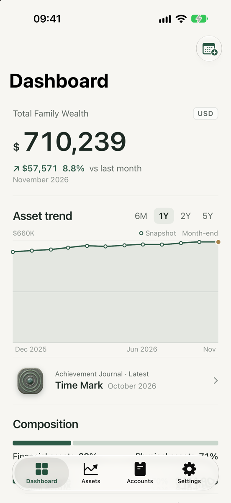
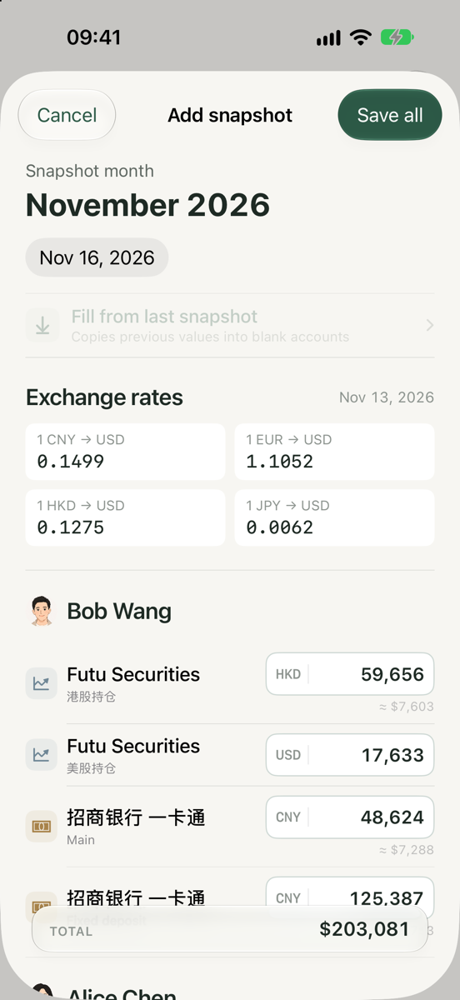
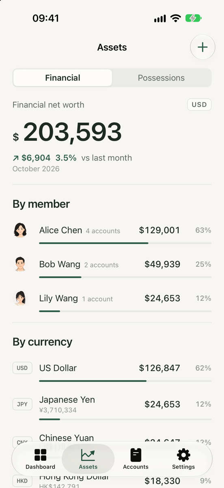
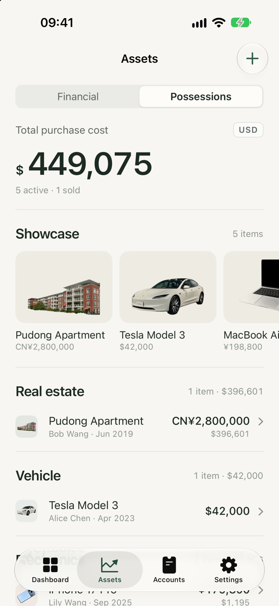
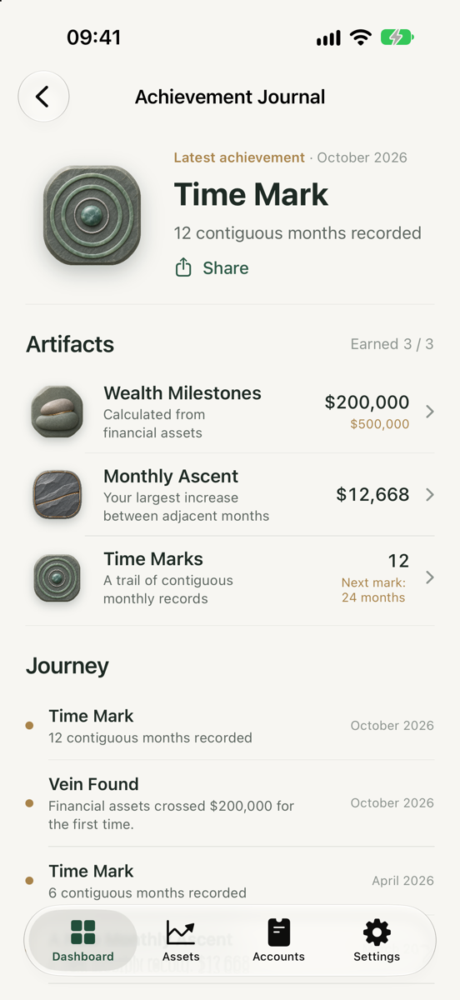

<p align="center">
  
</p>

<h1 align="center">Cairn</h1>

<p align="center">
  A local-first app for tracking your family's net worth on Mac, iPhone and iPad.
</p>

<p align="center">
  <a href="https://github.com/zhuangqh/cairn/releases/latest"><b>Download for Mac</b></a> ·
  <a href="https://zhuangqh.github.io/cairn/">Website</a> ·
  <a href="README.zh-Hans.md">简体中文</a>
</p>

<p align="center">
  
  
  <a href="LICENSE"></a>
</p>

Cairn keeps a record of what everyone in your family owns: bank accounts,
brokerage holdings, homes, cars and devices, in any currency. Once a month you
enter the latest balances, and Cairn converts everything into one home currency,
shows how the total changed, and keeps the history. All data stays on your device.

<table>
  <tr>
    <td align="center"><br><sub>Dashboard</sub></td>
    <td align="center"><br><sub>Monthly snapshot</sub></td>
    <td align="center"><br><sub>Assets</sub></td>
    <td align="center"><br><sub>Possessions</sub></td>
    <td align="center"><br><sub>Achievement Journal</sub></td>
  </tr>
</table>

## Features

- **Dashboard and history.** Total net worth, month-over-month change, a trend
  chart, and breakdowns by member, currency and asset type.
- **Monthly snapshots.** One sheet lists every holding, prefilled with last
  month's values. Change what moved and save everything at once.
- **Family members and accounts.** Add each member, their accounts, and the
  holdings in each account. An account can hold several currencies.
- **Multi-currency totals.** Balances are converted to your home currency with
  public ECB exchange rates. Each month's rates are saved with its snapshot, so
  past totals don't change.
- **Possessions.** Record homes, cars, electronics and other items with their
  purchase cost and a photo; the background is removed on the device.
- **Achievement journal.** Medals for wealth milestones, your largest monthly
  increase, and unbroken streaks of monthly records. Share cards never show an
  amount.
- **Backups.** Export and restore all data as a single `.cairn` file.
- **English and Simplified Chinese.**

## Privacy

Data is stored in a local SwiftData database with iCloud sync turned off. The
only network request is for public exchange rates from
[Frankfurter](https://frankfurter.dev). There are no accounts, analytics or ads.

## Install

- **Mac** — download the latest `.dmg` from
  [Releases](https://github.com/zhuangqh/cairn/releases/latest) and drag Cairn to
  Applications. The build isn't notarized yet, so open it the first time with
  Control-click › **Open**.
- **iPhone and iPad** — build from source with Xcode and a free Personal Team.

## Build from source

Requires Xcode 26 or later, [XcodeGen](https://github.com/yonaskolb/XcodeGen) and
[SwiftLint](https://github.com/realm/SwiftLint).

```sh
brew install xcodegen swiftlint
make gen     # generate Cairn.xcodeproj
make build   # build for macOS
make test    # run unit tests
```

See the [development guide](docs/development.md) for iOS builds, screenshots and
releases, and [AGENTS.md](AGENTS.md) for contribution conventions.

## License

Apache License 2.0 — see [LICENSE](LICENSE) and [NOTICE](NOTICE).
