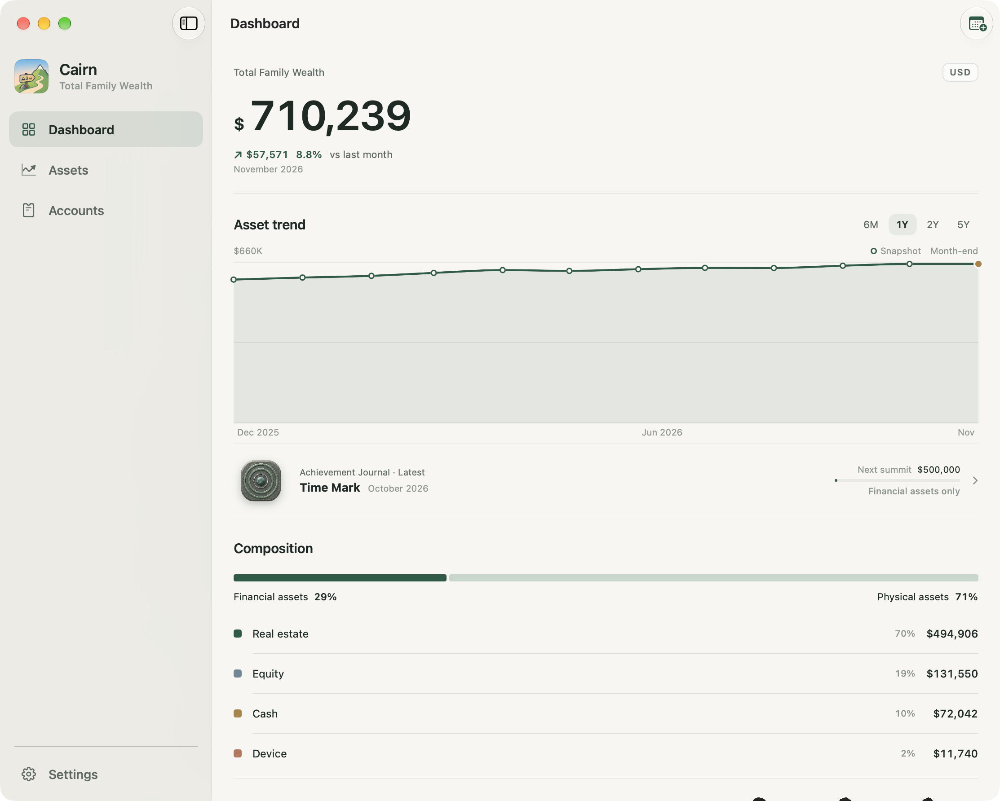
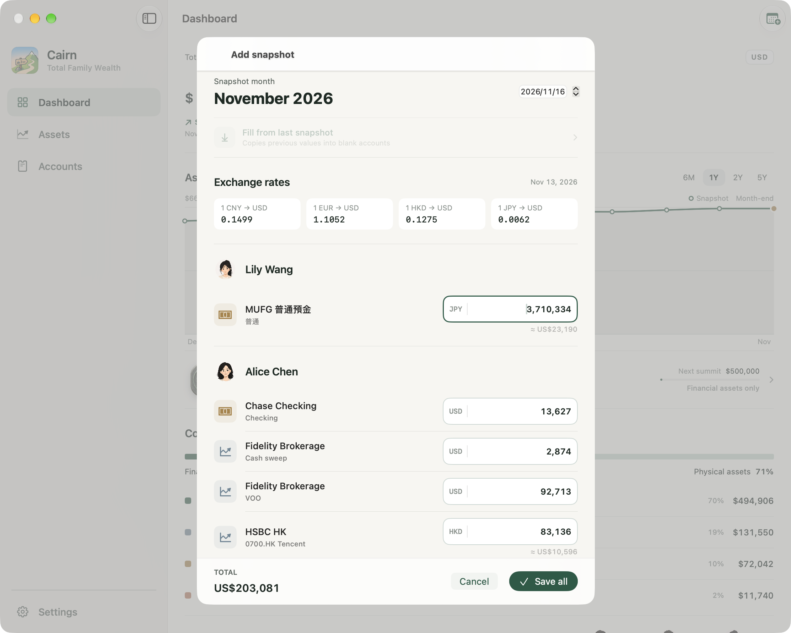
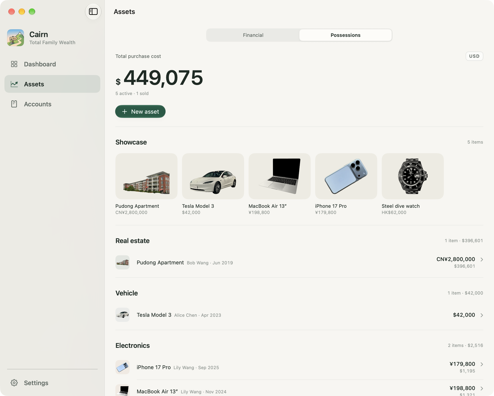
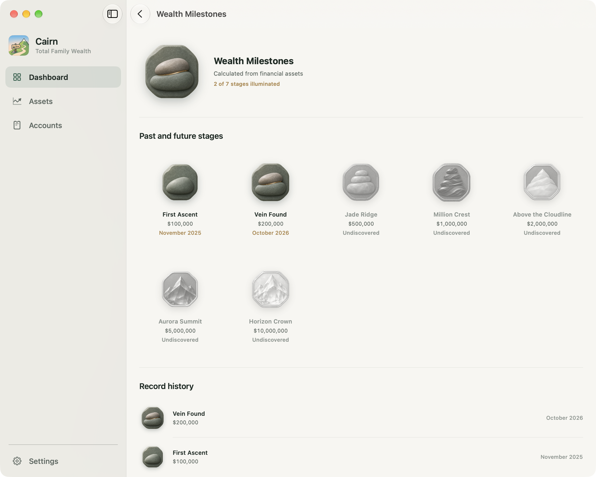

<p align="center">
  
</p>

<h1 align="center">Cairn</h1>

<p align="center">
  <b>The quiet ledger for your family's wealth.</b><br>
  Every member, account and currency in one calm statement — stored only on your devices.
</p>

<p align="center">
  <a href="https://github.com/zhuangqh/cairn/releases/latest"><b>Download for Mac</b></a> ·
  <a href="https://zhuangqh.github.io/cairn/">Website</a> ·
  <a href="README.zh-Hans.md">简体中文</a>
</p>

<p align="center">
  
  
  <a href="LICENSE"></a>
</p>

<p align="center">
  
</p>

## Why Cairn

- **A few minutes, once a month.** One sheet lists every holding with its last value
  filled in. Change what moved and save it all at once.
- **The whole family, in every currency.** See who holds what, converted to your home
  currency with public ECB rates, and why each month changed.
- **The things you own, on a shelf.** Homes, cars and devices sit beside your accounts,
  with photos cut out on the device.
- **Milestones worth marking.** A private journal of carved-stone medals. Share cards
  never show an amount.

<table>
  <tr>
    <td></td>
    <td></td>
    <td></td>
  </tr>
</table>

## Privacy

Your data lives in a local store on your devices, with iCloud sync turned off. The
only network request Cairn makes is for public exchange rates — no accounts, no
analytics, no ads. Back up everything to a single `.cairn` file you keep yourself.

## Download

- **Mac** — download the latest `.dmg` from
  [Releases](https://github.com/zhuangqh/cairn/releases/latest) and drag Cairn to
  Applications. The build isn't notarized yet, so open it the first time with
  Control-click › **Open**.
- **iPhone and iPad** — build from source with Xcode and a free Personal Team.

## Build from source

Requires Xcode 26 or later, [XcodeGen](https://github.com/yonaskolb/XcodeGen) and
[SwiftLint](https://github.com/realm/SwiftLint).

```sh
brew install xcodegen swiftlint
make gen     # generate Cairn.xcodeproj
make build   # build for macOS
```

See the [development guide](docs/development.md) for tests, iOS builds, screenshots and
releases, and [AGENTS.md](AGENTS.md) for contribution conventions.

## License

Apache License 2.0 — see [LICENSE](LICENSE) and [NOTICE](NOTICE).

<sub>A cairn is a stack of stones hikers leave to mark the trail. Each snapshot adds one more.</sub>
