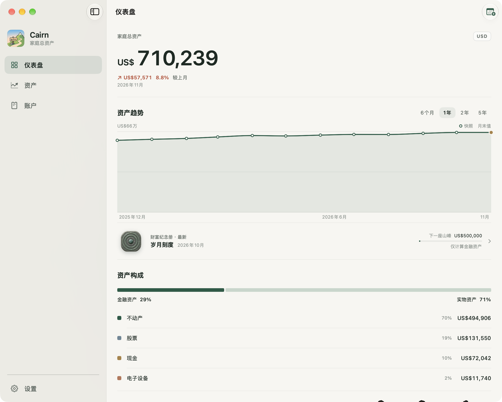
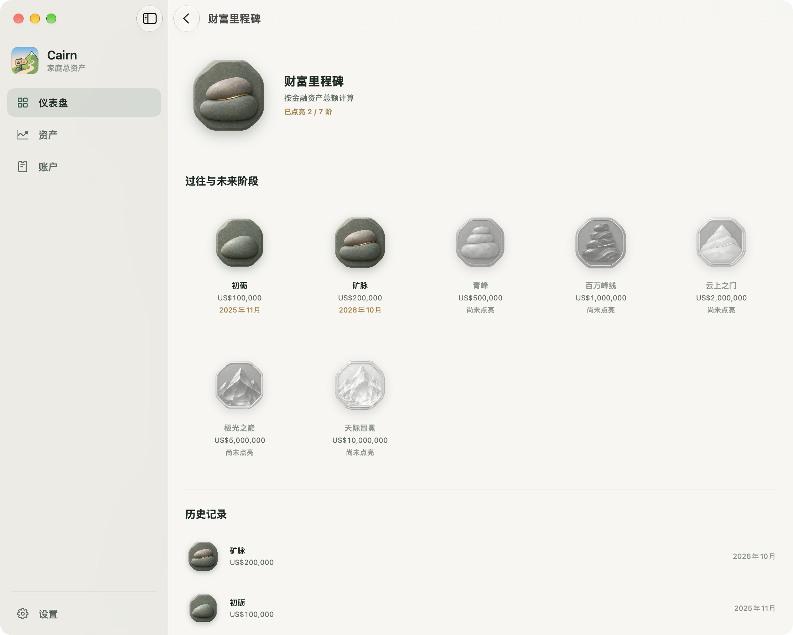

<p align="center">
  
</p>

<h1 align="center">Cairn</h1>

<p align="center">
  <b>给全家的资产，记一本安静的账。</b><br>
  每位家人、每个账户、每种货币，汇成一份平静的家庭报表，只存在你自己的设备上。
</p>

<p align="center">
  <a href="https://github.com/zhuangqh/cairn/releases/latest"><b>下载 Mac 版</b></a> ·
  <a href="https://zhuangqh.github.io/cairn/">官网</a> ·
  <a href="README.md">English</a>
</p>

<p align="center">
  
  
  <a href="LICENSE"></a>
</p>

<p align="center">
  
</p>

## 为什么是 Cairn

- **每月几分钟，就够了。** 一张表列出所有持仓，上次的数值已经填好。只改变动的几行，一次全部保存。
- **全家的钱，每种货币，一目了然。** 谁持有什么，都按欧洲央行公开汇率折算成本位币，每个月的变化来自哪里也清清楚楚。
- **家里的物件，摆上陈列柜。** 房子、车和数码设备与账户放在一起，照片在本机完成抠图。
- **值得纪念的里程碑。** 一本石刻奖章组成的私人日志，分享卡片上不会出现任何金额。

<table>
  <tr>
    <td></td>
    <td></td>
    <td></td>
  </tr>
</table>

## 隐私

数据保存在你设备上的本地数据库里，iCloud 同步保持关闭。Cairn 唯一的网络请求是获取公开汇率——没有账号、没有统计、没有广告。所有数据可以备份成一个由你自己保管的 `.cairn` 文件。

## 下载

- **Mac**：从 [Releases](https://github.com/zhuangqh/cairn/releases/latest) 下载最新的 `.dmg`，把 Cairn 拖进「应用程序」。目前安装包还没有经过 Apple 公证，第一次打开时请按住 Control 点按它，再选择**打开**。
- **iPhone 和 iPad**：用 Xcode 和免费的 Personal Team 从源码构建。

## 从源码构建

需要 Xcode 26 或更新版本、[XcodeGen](https://github.com/yonaskolb/XcodeGen) 和 [SwiftLint](https://github.com/realm/SwiftLint)。

```sh
brew install xcodegen swiftlint
make gen     # 生成 Cairn.xcodeproj
make build   # 构建 macOS 版
```

测试、iOS 构建、截图和发布流程见[开发指南](docs/development.md)，贡献约定见 [AGENTS.md](AGENTS.md)。

## 许可证

Apache License 2.0，详见 [LICENSE](LICENSE) 和 [NOTICE](NOTICE)。

<sub>Cairn 是登山者堆在路边的石堆，用来标记路径。每记下一次快照，就多放一块石头。</sub>
