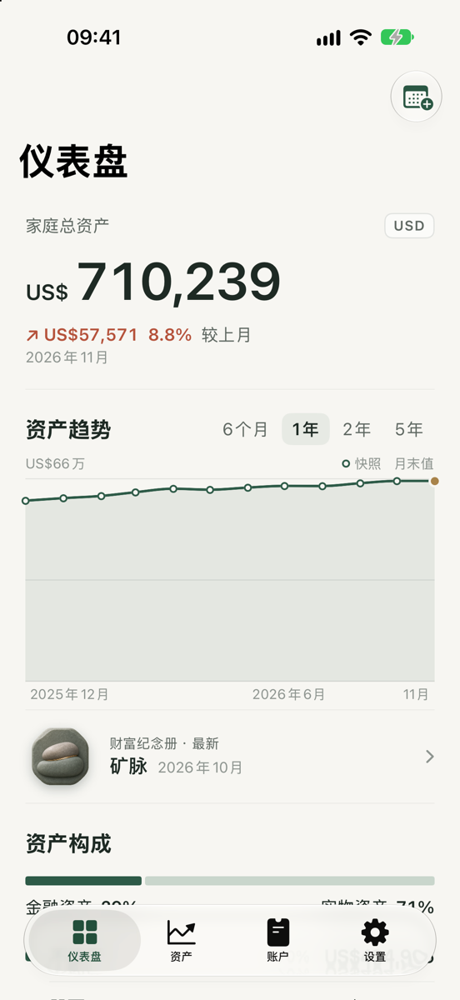
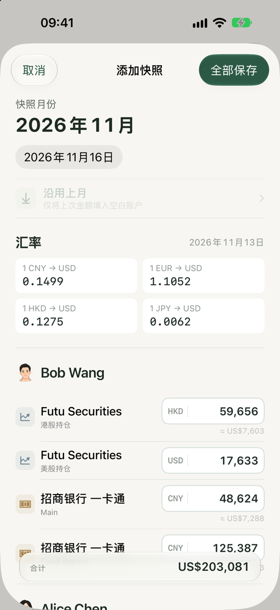
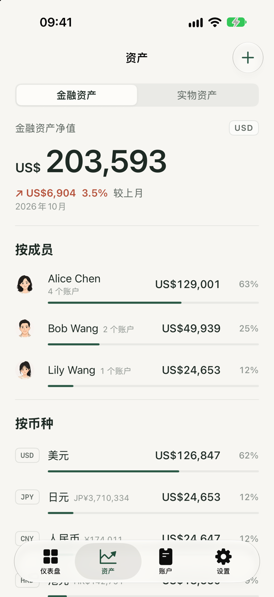
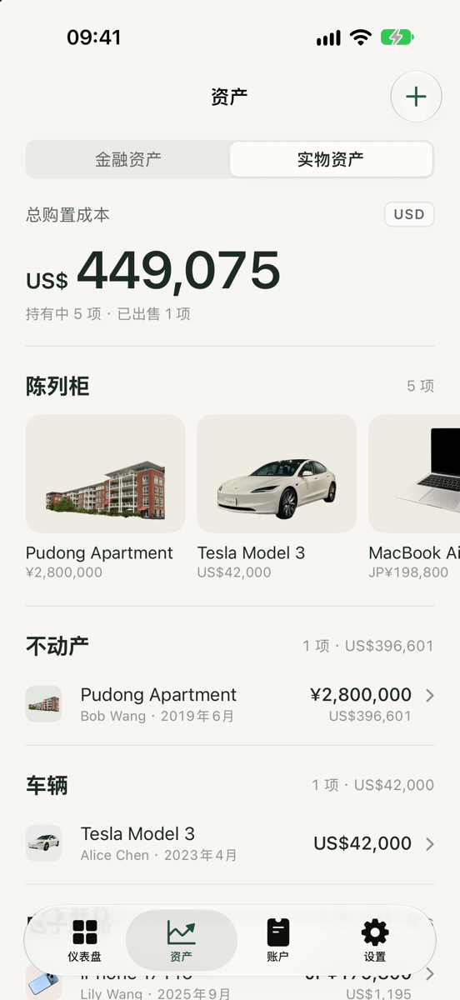
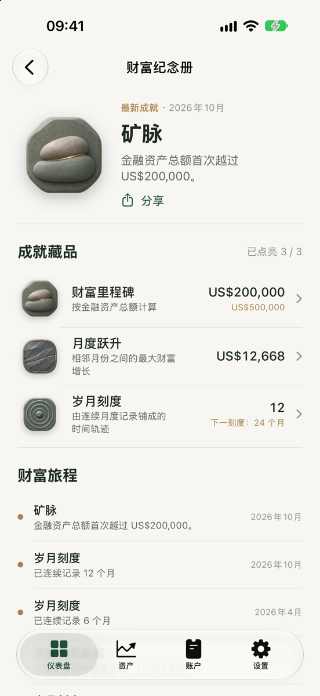

<p align="center">
  
</p>

<h1 align="center">Cairn</h1>

<p align="center">
  一款本地优先的家庭资产记录 App，支持 Mac、iPhone 和 iPad。
</p>

<p align="center">
  <a href="https://github.com/zhuangqh/cairn/releases/latest"><b>下载 Mac 版</b></a> ·
  <a href="https://zhuangqh.github.io/cairn/">官网</a> ·
  <a href="README.md">English</a>
</p>

<p align="center">
  
  
  <a href="LICENSE"></a>
</p>

Cairn 用来记录家里每个人名下的资产：银行账户、证券持仓、房子、车和数码设备，支持任意货币。
每月录入一次最新余额，Cairn 会把所有资产折算成同一种本位币，显示总额的变化，并保留历史记录。
所有数据只保存在你自己的设备上。

<table>
  <tr>
    <td align="center"><br><sub>仪表盘</sub></td>
    <td align="center"><br><sub>每月快照</sub></td>
    <td align="center"><br><sub>金融资产</sub></td>
    <td align="center"><br><sub>实物资产</sub></td>
    <td align="center"><br><sub>财富纪念册</sub></td>
  </tr>
</table>

## 功能

- **仪表盘与历史。** 总资产、月度变化、趋势图，以及按成员、币种和资产类型的构成。
- **每月快照。** 一张表列出所有持仓，并预填上月数值。只改有变动的几行，一次全部保存。
- **家庭成员与账户。** 为每位家人添加账户，以及账户里的各项持仓。一个账户可以持有多种货币。
- **多币种汇总。** 按欧洲央行公开汇率折算成本位币。每个月的汇率随快照一起保存，历史总额不会因汇率变动而改变。
- **实物资产。** 记录房子、车、数码设备等物品的购入价和照片，照片在本机完成抠图。
- **财富纪念册。** 为财富里程碑、单月最大增长和连续记录的月数点亮奖章。分享卡片不显示任何金额。
- **备份。** 所有数据可以导出为一个 `.cairn` 文件，也可以从中恢复。
- **支持英文和简体中文。**

## 隐私

数据保存在本地 SwiftData 数据库里，iCloud 同步保持关闭。唯一的网络请求是从
[Frankfurter](https://frankfurter.dev) 获取公开汇率。没有账号、没有统计、没有广告。

## 安装

- **Mac**：从 [Releases](https://github.com/zhuangqh/cairn/releases/latest) 下载最新的 `.dmg`，把 Cairn 拖进「应用程序」。目前安装包还没有经过 Apple 公证，第一次打开时请按住 Control 点按它，再选择**打开**。
- **iPhone 和 iPad**：用 Xcode 和免费的 Personal Team 从源码构建。

## 从源码构建

需要 Xcode 26 或更新版本、[XcodeGen](https://github.com/yonaskolb/XcodeGen) 和 [SwiftLint](https://github.com/realm/SwiftLint)。

```sh
brew install xcodegen swiftlint
make gen     # 生成 Cairn.xcodeproj
make build   # 构建 macOS 版
make test    # 运行单元测试
```

iOS 构建、截图和发布流程见[开发指南](docs/development.md)，贡献约定见 [AGENTS.md](AGENTS.md)。

## 许可证

Apache License 2.0，详见 [LICENSE](LICENSE) 和 [NOTICE](NOTICE)。
