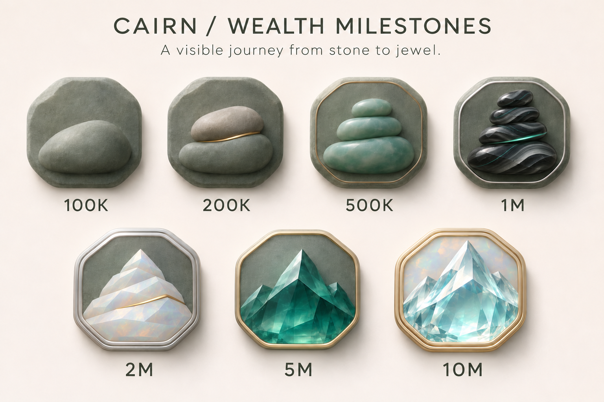
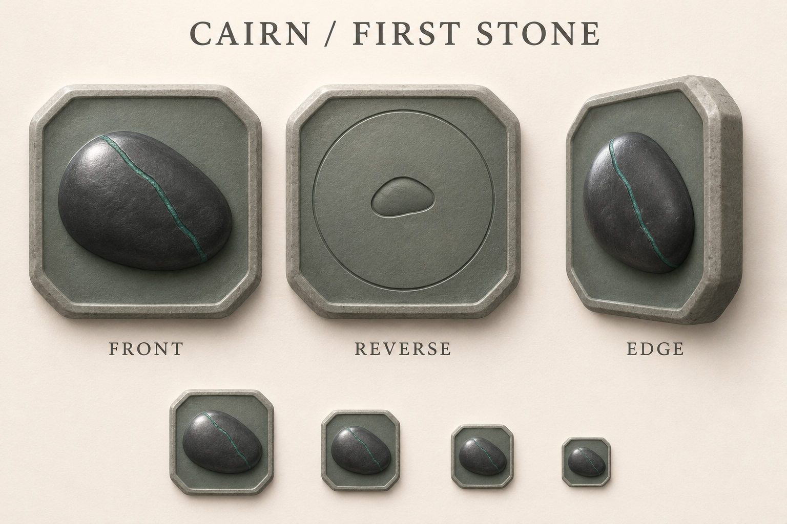
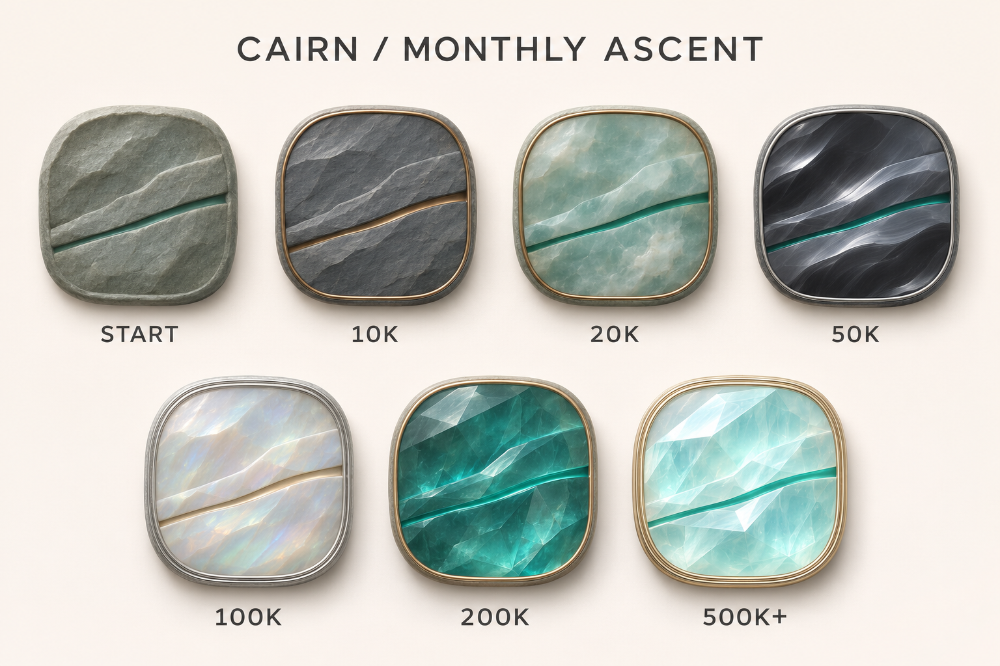
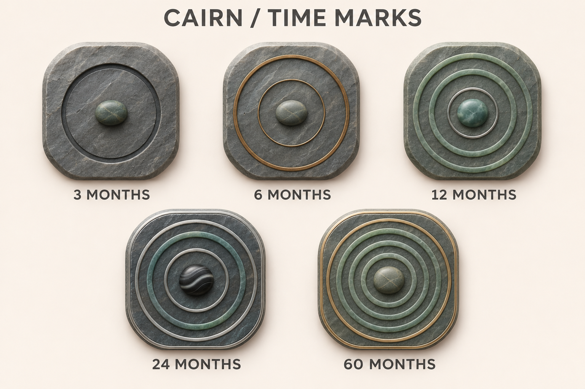

# Achievement icons

Cairn achievement artwork: design boards, the prompts that produced them, and how
the shipped assets map to achievement stages. Product rules live in
[`docs/achievement-system-design.md`](../../achievement-system-design.md).

- [Board prompts](board-prompts.md): prompts for every design board in [`boards/`](boards/).
- [Asset prompts](asset-prompts.md): prompts for every standalone icon in the asset catalog.

## Visual language

Every icon is a carved mineral seal: a nearly square grey-green stone plaque in
shallow relief, lit softly from the upper left. Each family has its own central
form, and tiers within a family advance through material, rim and clarity rather
than extra scenery. Icons contain no text or amounts; labels on the boards only
explain the stages.

| Family | Central form |
| --- | --- |
| First Stone | one dark alpine pebble with a teal seam |
| Wealth Milestones | stacked stones that resolve into faceted crystal peaks |
| Monthly Ascent | two rock strata lifted apart by a rising teal seam |
| Time Marks | a central pebble wrapped in one to five concentric mineral rings |

## Design boards

| Board | Covers |
| --- | --- |
| [`achievement-direction-v2.png`](boards/achievement-direction-v2.png) | First direction for all four families and the wealth material ladder |
| [`wealth-1m-candidate-v2.png`](boards/wealth-1m-candidate-v2.png) | Standalone 1M candidate |
| [`wealth-progression-v3.png`](boards/wealth-progression-v3.png) | Wealth tiers that differ by form, rim and clarity |
| [`wealth-progression-v4-obsidian-texture.png`](boards/wealth-progression-v4-obsidian-texture.png) | Approved wealth board: v3 with obsidian banding on 1M |
| [`first-stone-v1.png`](boards/first-stone-v1.png) | First Stone front, reverse and edge |
| [`monthly-ascent-v1.png`](boards/monthly-ascent-v1.png) | Monthly Ascent material stages |
| [`time-marks-v1.png`](boards/time-marks-v1.png) | Time Marks stages |

## Shipped assets

`AchievementBadgeView` picks the asset from the achievement family and stage key.
Stages without artwork fall back to the SwiftUI-drawn medal.

| Family | Stage key | Asset | Material |
| --- | --- | --- | --- |
| First Stone | `first-stone` | `AchievementFirstStone` | charcoal pebble, teal seam |
| Wealth | `wealth-0` | `AchievementWealth100K` | single alpine stone |
| Wealth | `wealth-1` | `AchievementWealth200K` | two stones, bronze seam |
| Wealth | `wealth-2` | `AchievementWealth500K` | three-stone jade cairn |
| Wealth | `wealth-3` | `AchievementWealth1M` | four-stone obsidian, silver rim |
| Wealth | `wealth-4` | `AchievementWealth2M` | faceted opal peak |
| Wealth | `wealth-5` | `AchievementWealth5M` | deep teal crystal peak, gold rim |
| Wealth | `wealth-6` | `AchievementWealth10M` | clear multi-peak crystal, double gold rim |
| Wealth | `wealth-7` and above | none | SwiftUI fallback |
| Monthly Ascent | `ascent-0` | `AchievementAscentStart` | alpine stone |
| Monthly Ascent | `ascent-1` | `AchievementAscent10K` | slate with bronze seam |
| Monthly Ascent | `ascent-2` | `AchievementAscent20K` | jade |
| Monthly Ascent | `ascent-3` | `AchievementAscent50K` | obsidian flow bands |
| Monthly Ascent | `ascent-4` | `AchievementAscent100K` | opal |
| Monthly Ascent | `ascent-5` | `AchievementAscent200K` | deep teal crystal |
| Monthly Ascent | `ascent-6` and above | `AchievementAscent500K` | pale aquamarine crystal |
| Time Marks | `time-3` | `AchievementTime3` | one ring |
| Time Marks | `time-6` | `AchievementTime6` | two rings |
| Time Marks | `time-12` | `AchievementTime12` | three rings, jade pebble |
| Time Marks | `time-24` | `AchievementTime24` | four rings, obsidian pebble |
| Time Marks | `time-60` | `AchievementTime60` | five rings, gold inlay |

Monthly Ascent stage keys come from
`AchievementService.monthlyAscentMaterialIndex(for:)`. The amounts on the board
(10K, 20K, …) are tier thresholds in the record's own currency, not a fixed currency.

### Reverse faces

Image medals rotate a full 360° when inspected, so each one has a matching back:
First Stone uses the chamfered `AchievementStoneReverse`, and every other image
medal uses `AchievementRoundedReverse`. Front and back are separate images, not
one 3D model, so their outlines are close but not identical.

All assets are 1254 × 1254 RGBA PNGs with the generated alpha left unedited.
