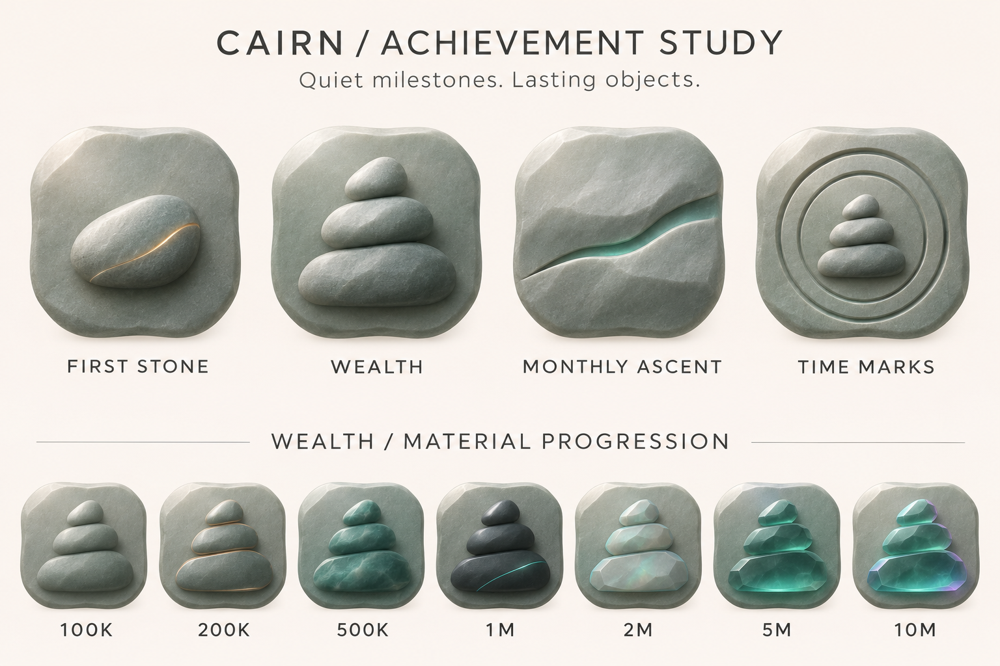
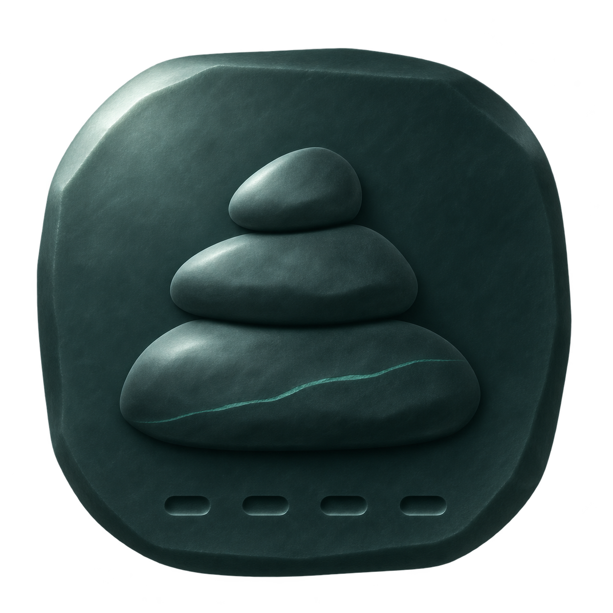
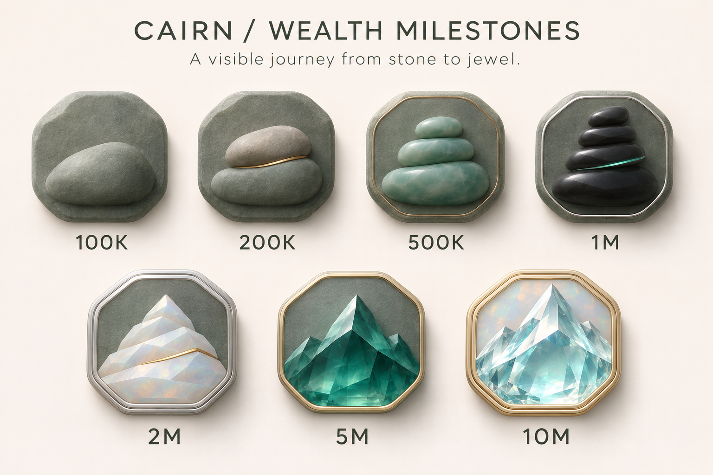
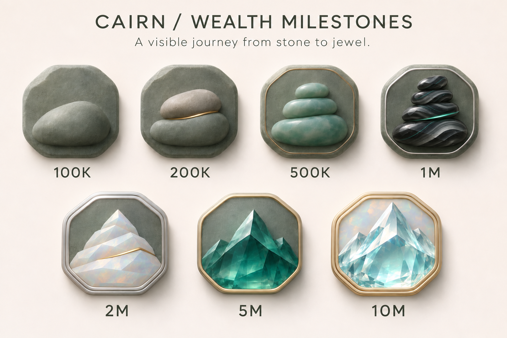
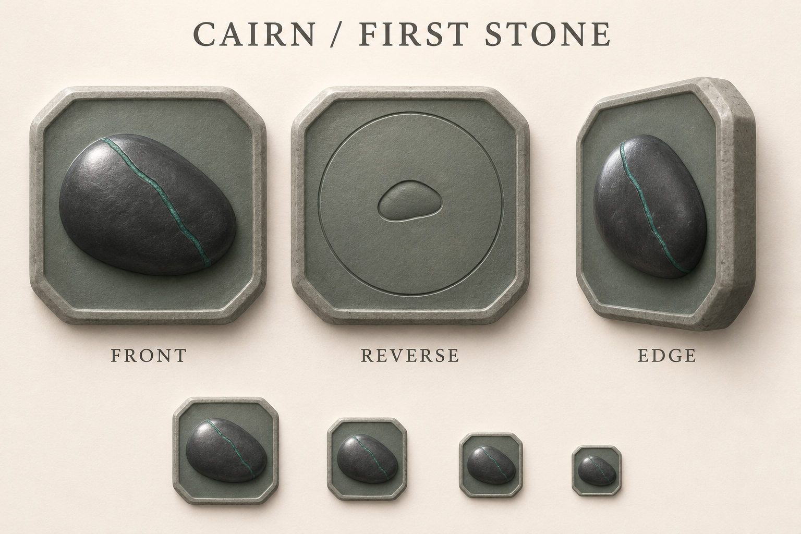
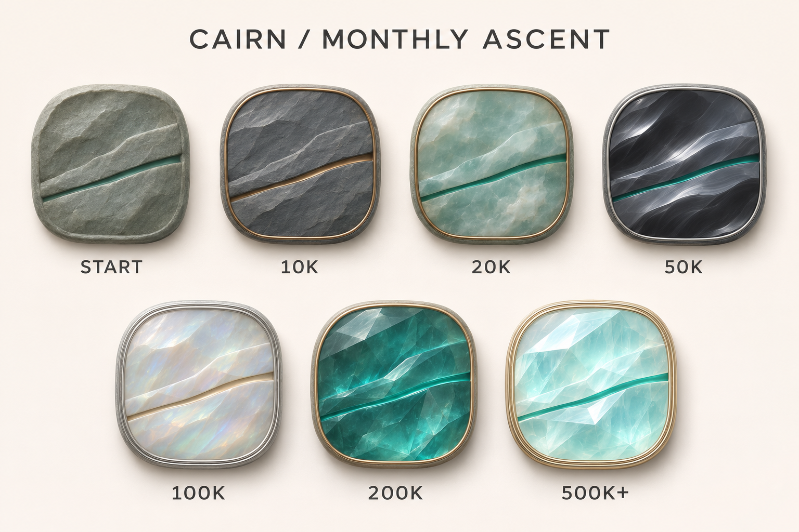
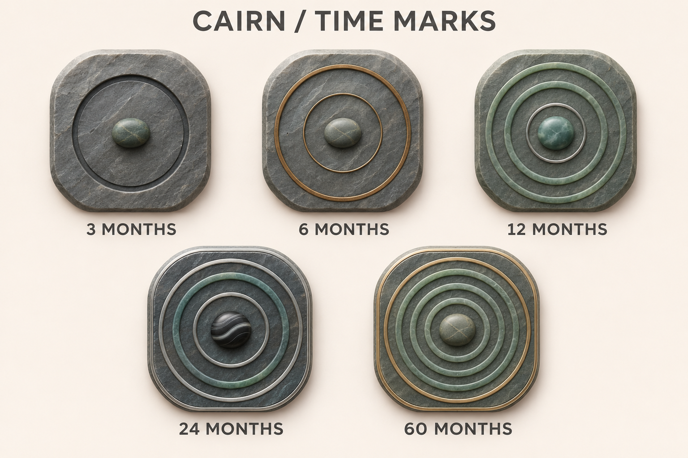

# Board prompts

Prompts for the design review boards in [`boards/`](boards/), listed in the order they were made. Boards are style references with labels and backgrounds; they are not shipped assets.

## achievement-direction-v2.png



- `transparent_background: false`
- First pass at a shared look for all four families, plus a material ladder for wealth.

```text
Use case: stylized-concept. Asset type: a polished achievement icon redesign review board for Cairn, a calm premium local-first family net-worth app for macOS and iPhone. Create one landscape design board with a warm off-white background, sparse editorial layout, exceptionally tasteful mineral sculpture icons. Title exactly 'CAIRN / ACHIEVEMENT STUDY'. Subtitle exactly 'Quiet milestones. Lasting objects.' Top row: four evenly spaced large individual achievement artifacts, labeled exactly 'FIRST STONE', 'WEALTH', 'MONTHLY ASCENT', 'TIME MARKS'. Each uses the SAME softly irregular chamfered stone-seal silhouette, nearly square with subtly rounded corners, shallow sculptural relief, soft upper-left studio light, consistent front facing view, restrained depth, fine smooth satin mineral texture, broad legible shapes, negative space, muted alpine teal and grey. FIRST STONE: one solitary smooth pebble with a tiny warm seam. WEALTH: three clean stacked stones rising toward a peak. MONTHLY ASCENT: two broad rock strata gently lifted apart by one narrow ascending teal seam. TIME MARKS: a small cairn enclosed by two clearly readable carved concentric trail rings. No scenic backgrounds inside the seals. No clouds, trees, roads, vegetation, crowns, stars, gems attached, busy cracks, thick outlines, game loot styling, dramatic fantasy effects, or harsh low-poly facets. Bottom row labeled exactly 'WEALTH / MATERIAL PROGRESSION': seven smaller evenly spaced WEALTH artifacts all using exactly the same clear three-stone motif, composition and outer silhouette as top WEALTH. Under them labels exactly '100K', '200K', '500K', '1M', '2M', '5M', '10M'. Progression: matte alpine grey-green stone; stone with subtle bronze inlay; satin cloudy deep teal jade; dark satin obsidian with one hairline teal seam; pale grey-green opal with subdued edge tint; translucent deep teal crystal with subtle inner light; the same refined crystal with tiny teal-violet iridescent edge accents. Differentiate stages through material and small controlled edge cuts, never by more scenery or saturation. All artifacts are clearly separate, equally scaled and unobscured, enough space between rows, attractive but readable at small UI sizes. Use professional quiet sans-serif typography in dark grey, no extra text, no watermark. This is a concept board, not an app screenshot.
```

## wealth-1m-candidate-v2.png



- `transparent_background: true`
- Standalone 1M candidate used to check a transparent single-icon output.

```text
Use case: stylized-concept. Asset type: standalone transparent PNG achievement icon candidate for Cairn's 1M wealth milestone. A single premium satin obsidian stone seal, front facing, centered on a square transparent canvas, occupy approximately 82 percent of canvas width and height with equal margins. Softly irregular chamfered nearly-square silhouette, subtle rounded corners and thin sculptural depth. On the seal three smooth broad stacked stones form a clear cairn in shallow raised relief, lower stone wide, middle narrower, top a small rounded pebble, generous negative space around the cairn. Mineral palette: deep alpine grey teal #243D3A and near-black green #102321 with broad soft grey-green upper-left edge illumination. ONE very restrained thin teal mineral seam across the lower raised stone, no glow spilling off the object. Four small evenly spaced clearly cut indentations along the lower seal edge give the stage a physical progression cue. Sophisticated quiet sculpted industrial design, smooth satin fine-grained stone, strong legible silhouette and simple readable forms suitable for 40-56 pt as well as 150 pt UI. Gentle studio upper-left lighting, no floor, no background, no scene, genuinely transparent surrounding alpha, no baked checkerboard, no external shadow or aura. No text or numerals, no brand lettering, no frame around a scene, no mountains or scenery, no clouds, no path, no plants, no metal trophy, no crown, no sparkles, no rainbow, no noisy cracks, no harsh polygonal facets, no game fantasy styling. Exactly one isolated achievement artifact, crisp anti-aliased edges.
```

## wealth-progression-v3.png



- `transparent_background: false`
- Makes the wealth tiers differ by form, rim and clarity, not only by color.

```text
Use case: stylized-concept. Asset type: second iteration achievement milestone review board for Cairn, a quiet premium family net-worth app. Create a landscape editorial board, warm off-white background, calm refined sans-serif typography. Title exactly 'CAIRN / WEALTH MILESTONES'. Subtitle exactly 'A visible journey from stone to jewel.' Seven individual achievement seals arranged in a spacious progression: four on top row labeled exactly '100K', '200K', '500K', '1M'; three centered on bottom row labeled exactly '2M', '5M', '10M'. ALL seals have equal outer visual size, same softly irregular chamfered almost square silhouette, front-facing shallow sculptural relief, consistent soft upper-left studio light, subtle shadow, large readable forms and generous negative space. Preserve tasteful minimal mineral sculpture aesthetic: no scene, clouds, plants, roads, coins, numbers baked into artifacts, fantasy trophies, crowns, sparkles, rainbow glow, loud saturation or ornament clutter. Key request: make the huge difference between 500K and 10M obvious even to a person with NO knowledge of mineral materials. Advance not only color but central sculptural architecture, faceting, luminous translucency, and craftsmanship of the bezel, while preserving family identity of stones rising to a mountain. Exact progression: 100K = plain matte alpine grey-green seal with one large rounded pebble, absolutely no metal rim. 200K = two broad stacked smooth stones, one restrained warm bronze inlay along a seam, plain stone outer edge. 500K = three simple rounded cloudy teal jade stacked stones, matte grey-green stone backing, tiny satin bronze inner edge detail only; beautiful but modest, low three-stone silhouette, opaque softly polished jade, no elaborate facets. 1M = four dark obsidian stones stacked into a more upright cairn, single hairline teal seam, clean thin continuous silver inner bezel. 2M = five pale opal stones resolving into a geometric alpine peak, crisp cut surfaces, clean double platinum bevel around the seal, tiny restrained gold seam. 5M = sculptural single deep teal cut-crystal mountain, a bold clear central ridge and two shoulder peaks, visibly translucent depth, refined thin champagne-gold bezel framing the mountain, a few deliberate broad jewel facets, no tiny clutter. 10M = clearly the most precious masterpiece: luminous pale icy aquamarine cut-crystal alpine summit, elevated tall central peak and two articulated side ridges, large exceptional polished gem facets with clear transparent inner depth and highlights, finely finished double champagne-gold outer bezel, a pale opal inset plane behind the crystal. Subdued teal anchor, restrained gold, brighter luminous crystal contrasts clearly with 500K's dark opaque three smooth pebbles. Luxury must read through geometry, craftsmanship, and optical clarity, NOT more visual noise. The seven stages should have clearly different silhouettes of their central sculpture even in greyscale and at small scale. Highest tier remains modern, calm and desirable like a collectible fine jewelry object, not game loot. Labels below objects only; no extra copy or watermark. Precisely seven seals, no duplicates. This is a concept review board, not an app screenshot.
```

## wealth-progression-v4-obsidian-texture.png



- `transparent_background: false`
- Edit of `wealth-progression-v3.png`: adds obsidian flow banding to 1M. **Approved wealth reference.**

```text
Use case: precise-object-edit. Edit the supplied Cairn wealth milestone review board. CHANGE ONLY the material surface of the four black obsidian stacked stones in the 1M seal at TOP RIGHT. Preserve the exact entire board layout, typography, all labels, background, lighting, seal backing and silver bezel, the four-stone silhouette and positioning, and ALL SIX OTHER MILESTONE ARTIFACTS unchanged. User request: the 1M obsidian looks like plain black stones; give it more recognizable rich mineral texture without losing the minimal style. On these four stones add clearly visible but restrained flowing charcoal-and-silver-grey geological bands, broad layered volcanic-glass swirls, a few elegant hairline teal mineral veins, and smooth curved conchoidal fracture planes with polished glassy edge highlights. The texture should be visible at this board's viewing size: use medium-scale graceful flowing bands rather than tiny noise. Keep black obsidian identity, deep black-green base, moderate silver-grey contrast, subtle translucent smoky edge depth, a controlled mix of satin surfaces and polished facets. Keep existing teal seam, integrate it naturally with new fine mineral veins. Make these four stones look like carefully selected and polished precious obsidian with distinctive natural texture, more crafted and valuable than 500K jade, but darker and quieter than 2M opal and the crystal peaks. Avoid dense crack networks, speckles, marble-white dominant coloring, gold, excessive glow, rainbow, chipped rough edges, or extra objects. Do not alter any text or any other milestone. Output the full board with the 1M surface texture revised.
```

## first-stone-v1.png



- `transparent_background: false`
- Style reference: `wealth-progression-v4-obsidian-texture.png`. Front, reverse and edge views of First Stone.

```text
Use case: stylized-concept. Asset type: Cairn achievement icon design review board. Create a beautifully finished landscape review board on warm off-white background with quiet dark-grey typography. The previous Cairn wealth milestone board visible in the conversation is a STYLE REFERENCE ONLY, not an edit target. Match its premium mineral shallow relief, softly chamfered nearly square stone plaque, matte grey-green backing, realistic upper-left studio illumination, careful craftsmanship. This board covers FIRST STONE and a proposed common reverse for fully rotating medals. Title exactly 'CAIRN / FIRST STONE'. Three equally sized large plaques in one row, same outer dimensions and nearly square chamfered silhouette: left labeled 'FRONT', center labeled 'REVERSE', right labeled 'EDGE'. FRONT: a SINGLE broad solitary dark charcoal alpine pebble, smooth sculptural asymmetric oval, one fine restrained teal mineral seam descending diagonally through its surface. One stone only, centered in spacious matte grey-green shallow inset backing. Modest plain stone rim, no metal jewelry frame for this starting achievement. Pale satin highlights on broad pebble surface so it remains readable on dark UI. No mountains, no stack, no scenic objects. REVERSE: precisely the same outer contour, material, chamfer geometry and thickness as FRONT, shown directly from back. Quiet recessed grey-green stone field, one small centrally engraved solitary pebble glyph and a subtle thin circular seal groove. No text engraved on the object. Reverse feels crafted as the back of the SAME artifact, not a different polygon. EDGE: the same complete artifact seen in a three-quarter rotated angle roughly 65 degrees, showing its shallow solid stone thickness and bevel clearly, teal seam stays on front surface, no imaginary detached layers. This preserves the concept of a complete 360-degree rotation. Below these three large views, place a discreet row of four modest small front-facing FRONT icons demonstrating clear solid shape at decreasing sizes, without any extra labels. All objects fully visible, no crops, equal spacing, quiet soft contact shadows on review background only. The same subdued alpine-grey palette across all panels, restrained teal only in the seam. Broad shapes designed for tiny UI icons. No excessive cracks, sparkles, aura, rays, glass gems, scenery, arrows, floating pieces, ribbon, text on medals, watermark, mock app UI, or additional captions. This is a considered sculptural icon study, not a product screenshot.
```

## monthly-ascent-v1.png



- `transparent_background: false`
- Style references: the wealth v4 board and `first-stone-v1.png`. Seven Monthly Ascent material stages.

```text
Use case: stylized-concept. Asset type: Cairn Monthly Ascent seven-stage icon concept board. Create one polished landscape board, warm off-white background, minimal professional SANS-SERIF dark-grey typography. Title exactly 'CAIRN / MONTHLY ASCENT'. Reference the Cairn wealth milestone style already visible: softly irregular chamfered almost square grey-green stone seals, consistent directly front-facing shallow sculptural relief, refined slim bezel only when appropriate, soft upper-left studio lighting. The generated First Stone board is another reference for the system, but keep rims slimmer and the relief shallower than that study. Design a DISTINCT Monthly Ascent family symbol: two broad solid mineral strata slant gently upward from lower left to upper right, separated by a clean narrow ascending gap. The upper stratum is lifted slightly higher, indicating upward geological movement. This must look like a mineral sculptural object, NOT a chart, arrow, mountain peak, stacked pebbles or lightning bolt. A single clean rising teal mineral seam emphasizes the gap. Preserve this two-strata motif at all seven stages, broad clear silhouettes, enough empty space above and below. Exactly seven separate equally sized seals laid out four in top row and three centered beneath, aligned consistent scale, generous spacing, fully visible. Labels BELOW objects only, in exact order: top row 'START', '10K', '20K', '50K'; bottom row '100K', '200K', '500K+'. START: opaque matte grey-green alpine rock, two thick simple rising strata, subtle teal gap, plain modest stone rim. 10K: slate grey strata with a restrained bronze mineral line following the ascending gap, one slim bronze inset rim. 20K: cloudy pale teal jade strata, smooth satin cloudy mineral inclusions, fine bronze inset rim. 50K: polished charcoal obsidian strata, strong broad flowing silver-grey volcanic-glass bands for small-size legibility, hairline teal gap, fine silver inset rim. 100K: pale muted opal strata with broad soft mineral sheen and light warm seam, refined double silver inset rim. 200K: deep translucent teal crystal strata with only a few broad cut faces and visible inner depth, champagne-gold thin rim. 500K+: brightest pale icy aquamarine strata, luminous clear inner depth and large polished geometric cut faces, refined double champagne-gold rim, pale opal backing, still precisely TWO rising rock strata, no summit, no crown or extra jewel. Increasing craftsmanship and material clarity, not increasing clutter. Keep central symbol distinct from the wealth cairn/mountain family and the concentric-ring Time Marks family even in greyscale. Soft contact shadows on review background, no external aura, sparkles, rays, floor scene, trees, scenery, ticker, financial charts, currency signs, text or numbers ON medals, extra labels, watermark, app mockup. Exact seven seals, no duplicate stages. These labels describe candidate MATERIAL transitions for a personal-best monthly amount, not any change to achievement rules.
```

## time-marks-v1.png



- `transparent_background: false`
- Style references: the wealth v4 board, `first-stone-v1.png` and `monthly-ascent-v1.png`. Five Time Marks stages.

```text
Use case: stylized-concept. Asset type: Cairn Time Marks five-stage achievement icon design review board. Create one polished landscape board with warm off-white background and restrained professional dark-grey SANS-SERIF typography, title exactly 'CAIRN / TIME MARKS'. Visible Cairn wealth milestone, First Stone and Monthly Ascent boards are STYLE REFERENCES ONLY. Match their softly chamfered nearly square stone seal contour, quiet premium shallow sculptural mineral relief, consistent frontal view, thin carefully finished bevels, soft upper-left studio light. This family celebrates keeping a monthly record, so it should feel patient, durable and warm rather than expensive wealth trophies. Its DISTINCT central motif is a single SMALL smooth oval alpine stone at the exact center, encircled by broad clean concentric carved mineral rings like geological tree-age rings or a circular trail. NOT a clock, target, dial, calendar, coin, eyeball or camera lens. Each ring is a shallow recessed groove with a modest raised smooth stone ridge, visible and readable at tiny icon size, no dense etched lines. Exactly FIVE equally sized full front-facing seals: three across the top row and two centered below, generous spacing, same front outer contour and scale, labels below only. Top labels exactly '3 MONTHS', '6 MONTHS', '12 MONTHS'; bottom labels exactly '24 MONTHS', '60 MONTHS'. 3 MONTHS: small central smooth grey-green pebble and exactly ONE broad incomplete-looking organically carved circular groove? NO, use one fully closed clean circular groove, matte alpine slate backing, modest plain stone rim, dark groove and satin ridge visible. 6 MONTHS: same small pebble, exactly TWO concentric circular grooves, matte grey stone with one slender aged bronze inlay tracing outer groove, very thin bronze inner bezel. 12 MONTHS: same small cloudy teal jade pebble, exactly THREE spacious concentric ring grooves, satin muted jade mineral ridges inset into grey-green backing, one thin silver bezel; relatively large inner negative space around the pebble. 24 MONTHS: same small dark obsidian pebble with broad soft silver volcanic banding, exactly FOUR broad concentric stone rings, subdued charcoal-grey and teal stone, very restrained silver inlay on alternate outer rings, silver double rim. 60 MONTHS: same small warm grey-green alpine pebble, exactly FIVE well-spaced broad concentric mineral rings, durable satin jade and grey stone, thin aged champagne-gold inlays on two outer rings, refined slim double champagne-gold bezel, no large crystal centerpiece. All rings maintain calm moderate contrast; the small stone is always separated clearly from the first ring. Show progression in ring count and craft, preserve generous broad spacing and avoid overly dense 60-month icon. All metal is restrained, diffuse satin reflections, no bright jewelry bling. Central circle symbol must be unmistakably different from stacked wealth stones and slanted Monthly Ascent strata. No numerals, lettering or labels engraved on any seal, no 36-month stage, no diamonds, crown, star, clock hands, radial ticks, arrows, sparkles, aura, scenery, floor scene, watermark, extra captions, duplicate stages or app screenshot. Concept board only, soft contact shadows under objects.
```
